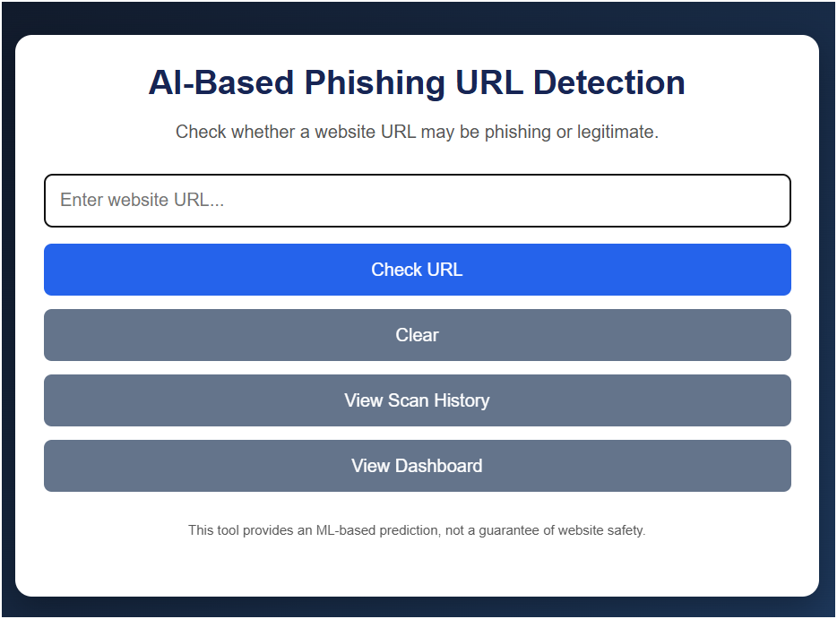
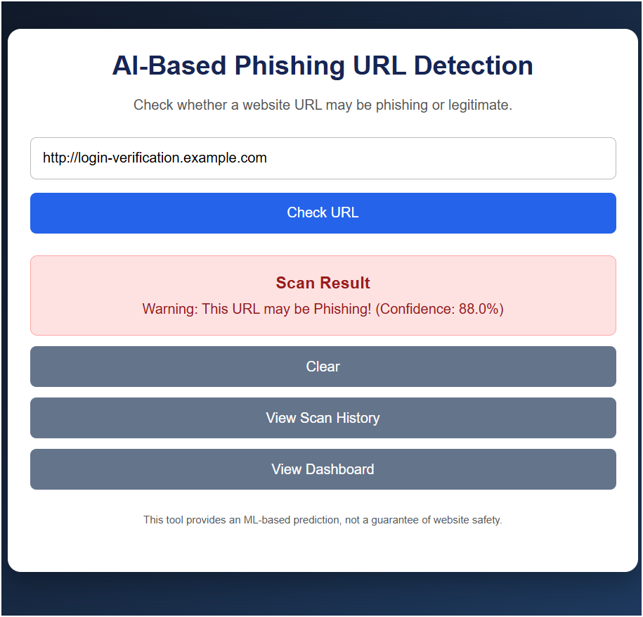
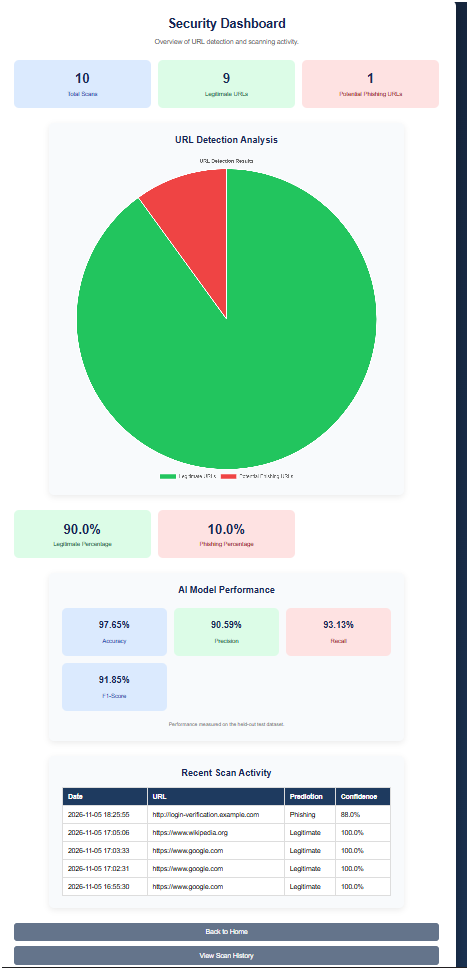
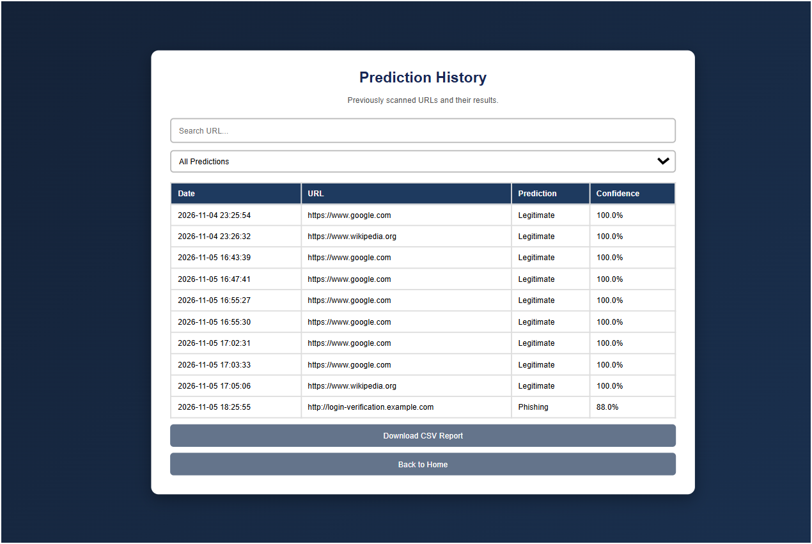

# AI-Based Phishing URL Detection System

## 1. Project Overview
The AI-Based Phishing URL Detection System is a machine learning web application that analyzes website URLs and predicts whether they are potentially phishing or legitimate.

## 2. Objectives
- Detect potentially phishing URLs.
- Identify suspicious URL patterns using machine learning.
- Provide prediction results with confidence scores.
- Maintain scan history.
- Display detection statistics through a dashboard.

## 3. Technologies Used
- Python
- Flask
- Machine Learning
- Random Forest Classifier
- HTML
- CSS
- JavaScript
- Pandas
- Scikit-learn

## 4. Dataset
The project uses a URL-based dataset containing 116,600 records:
- 100,000 Legitimate URLs
- 16,600 Phishing URLs
**Note:** The dataset is not included in this repository due to security and file-sharing considerations. Download the original dataset from [Mendeley Data](https://data.mendeley.com/datasets/65z9twcx3r/2) before running the model training script.

## 5. Machine Learning Model
Algorithm: Random Forest Classifier

Test Dataset Performance:
- Accuracy: 97.65%
- Precision: 90.59%
- Recall: 93.13%
- F1-Score: 91.85%

These results are measured on a held-out test dataset and do not guarantee real-world detection accuracy.

## 6. Main Features
- URL prediction
- URL input validation
- Prediction confidence
- Scan history
- Dashboard with pie chart
- CSV report export

## 7. Project Screenshots

### Homepage

### Phishing Detection Result

### Dashboard

### Scan History

## 8. Project Structure
- app.py
- feature_extraction.py
- train_url_model.py
- model/
- dataset/
- templates/
- static/
- requirements.txt

## 9. How to Run
1. Clone the repository.
2. Create a Python virtual environment.
3. Install dependencies:
   pip install -r requirements.txt
4. Run the application:
   python app.py
5. Open http://127.0.0.1:5000 in your browser.

## 10. Disclaimer
This application provides machine learning-based URL predictions for educational purposes. It does not guarantee that a website is safe or malicious.
## 11. Dataset Attribution

Dataset: URL-Phish: A Feature-Engineered Dataset for Phishing Detection

Authors: Linh Dam Minh and Hung Tran Cong

Source: https://data.mendeley.com/datasets/65z9twcx3r/2

License: Creative Commons Attribution 4.0 International (CC BY 4.0)